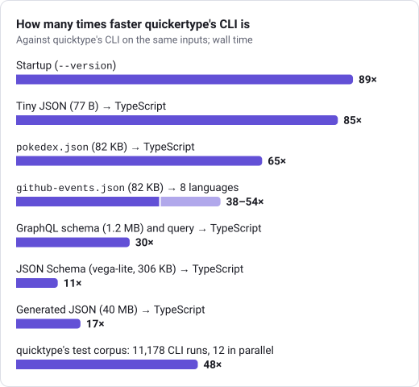
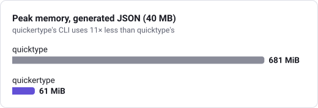
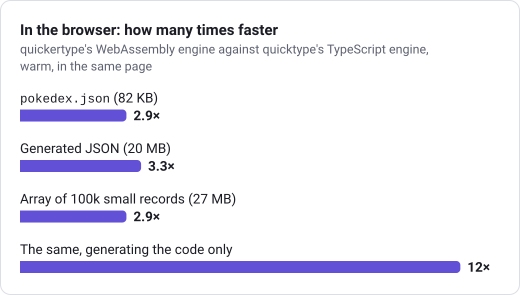

# quickertype

**quicktype, rewritten in Rust: the same CLI, the same API and the same
output, byte for byte apart from [a few fixed
bugs](docs/PARITY.md#bugs-fixed-in-quickertype), up to 89× faster.**

[](https://github.com/EloB/quickertype/actions/workflows/ci.yml)
[](https://elob.github.io/quickertype/app/)
[](https://crates.io/crates/quickertype)
[](https://www.npmjs.com/package/quickertype-core)
[](LICENSE)

quickertype is a port of [quicktype](https://github.com/glideapps/quicktype),
which generates types and serializers from JSON, JSON Schema, GraphQL,
Postman collections and TypeScript. It is a drop-in replacement:

- **The `quicktype` CLI,** as the `quickertype` command: the same flags,
  help text, messages, exit codes and output files, byte for byte, except
  the command's name in `--help`'s synopsis and examples, one addition,
  [JSON Lines](#json-lines) input, and the fixes of [bugs in the code
  quicktype generates](docs/PARITY.md#bugs-fixed-in-quickertype) (C, Ruby,
  Java with legacy dates, Python, and string enums in TypeScript input),
  each reported to quicktype with the same fix.
- **The `quicktype-core` JavaScript API** as
  [`quickertype-core`](npm/quicktype-core/README.md) on npm: quicktype's own
  TypeScript API and `.d.ts` files, with the engine compiled to WebAssembly,
  for Node.js 20+ and browsers. Change the import, nothing else.
- **A Rust API:** the `quickertype-core` crate, which the CLI and the
  WebAssembly engine are built on.

All 27 of quicktype's output languages: C (cJSON), C++, Crystal, C#, Dart,
Elixir, Elm, Flow, Go, Haskell, Java, JavaScript, JavaScript PropTypes,
JSON Schema, Kotlin, Objective-C, PHP, Pike, Python, Ruby, Rust, Scala 3,
Smithy, Swift, TypeScript, TypeScript Effect Schema and TypeScript Zod.

## Speed and memory

The CLI against quicktype's CLI on the same inputs; both write the same
files. Wall time, median of 10 runs:

<p>
<picture>
  <source media="(prefers-color-scheme: dark)" srcset="https://raw.githubusercontent.com/EloB/quickertype/main/docs/assets/charts/cli-speed-dark.svg">
  
</picture>
</p>

| Run | quicktype | quickertype | Faster |
|---|---:|---:|---:|
| Startup (`--version`) | 226 ms | 2.6 ms | 89× |
| Tiny JSON (77 B) → TypeScript | 246 ms | 2.9 ms | 85× |
| `pokedex.json` (82 KB) → TypeScript | 265 ms | 4.1 ms | 65× |
| `github-events.json` (82 KB) → 8 languages | 285–303 ms | 5.3–8.0 ms | 38–54× |
| GraphQL schema (1.2 MB) and query → TypeScript | 253 ms | 8.3 ms | 30× |
| JSON Schema (vega-lite, 306 KB) → TypeScript | 429 ms | 38 ms | 11× |
| Generated JSON (40 MB) → TypeScript | 2,786 ms | 166 ms | 17× |
| quicktype's test corpus: 11,178 CLI runs, 12 in parallel | 495 s | 10.2 s | 48× |
| Peak memory, generated JSON (40 MB) | 681 MiB | 61 MiB | 11× less |

<p>
<picture>
  <source media="(prefers-color-scheme: dark)" srcset="https://raw.githubusercontent.com/EloB/quickertype/main/docs/assets/charts/cli-memory-dark.svg">
  
</picture>
</p>

- **Large files:** a 2.6 GB JSON file becomes TypeScript types in 7.3 s
  at a peak of 64 MiB; memory grows with what is distinct in the JSON,
  not with its size. Scryfall cards (real data): 657 MB take 0.28 s and
  50 MiB, against quicktype's 28 s and 3.2 GiB, and the cards in every
  language (3.0 GB) take 1.3 s.
- **Several cores:** a file of 8 MiB or more whose top-level value is an
  array, or that holds JSON Lines, is read on all cores: an array of 1
  million records (267 MB) becomes TypeScript types in 50 ms instead of
  260 ms on a 12-core M2 Max, with the same output.
- **Where the time goes:** on small inputs, most of the difference is
  starting Node.js and loading quicktype (226 ms for `--version` alone);
  on large inputs it is the engine. As
  libraries in a warm process, the native engine is 4.0× faster than
  quicktype's TypeScript.
- **In the browser and on npm:** the table is the native CLI's. The
  WebAssembly engine behind quicktype's own API (`addSource`, then
  `quicktypeMultiFile` to TypeScript), warm in headless Chrome, against
  quicktype's TypeScript engine in the same page:

  <p>
  <picture>
    <source media="(prefers-color-scheme: dark)" srcset="https://raw.githubusercontent.com/EloB/quickertype/main/docs/assets/charts/browser-speed-dark.svg">
    
  </picture>
  </p>

  | Input | quicktype | quickertype | Faster |
  |---|---:|---:|---:|
  | `pokedex.json` (82 KB) | 4.7 ms | 1.6 ms | 2.9× |
  | Generated JSON (20 MB) | 407 ms | 122 ms | 3.3× |
  | Array of 100k small records (27 MB) | 156 ms | 53 ms | 2.9× |
  | The same, generating the code only | 76 ms | 6.2 ms | 12× |

  A first run also compiles the 5 MiB engine: in a fresh Node process,
  `pokedex.json` takes 50 ms against quicktype's 28 ms, and the records
  109 ms against 233 ms.

  The playground reads a large file on up to 8 workers at once. On
  Scryfall cards (real data), 100 to 537 MB, it is 17× to 25× faster than
  quicktype in the same page, warm (0.40 s against 10.2 s at 537 MB, in
  a quarter of the memory); the whole 657 MB file, which quicktype cannot
  read in a browser, takes 0.48 s.

Measured on November 15, 2026, on an Apple M2 Max (12 cores, 64 GiB),
macOS 26.6.2, Node.js 24.16.0, Chrome 157, rustc 1.99.1. Method, every
benchmark and how to reproduce them:
[docs/BENCHMARKS.md](docs/BENCHMARKS.md) and the
[benchmarks page](https://elob.github.io/quickertype/benchmarks.html).

## Try it

The [playground](https://elob.github.io/quickertype/app/) runs quicktype's API on
the WebAssembly engine in your browser. Its engine switch runs the same input
on quicktype's own TypeScript engine, to compare output and time.

## Install

Prebuilt binaries for macOS, Linux and Windows are on the
[releases page](https://github.com/EloB/quickertype/releases).

```sh
brew install elob/tap/quickertype     # Homebrew (macOS, Linux)
npm install -g quickertype            # npm; or run it once with: npx quickertype
cargo install quickertype             # Cargo, builds from source (Rust 1.88+)

# Shell installer (macOS, Linux)
curl --proto '=https' --tlsv1.2 -LsSf https://github.com/EloB/quickertype/releases/latest/download/quickertype-installer.sh | sh
```

On Windows, run `quickertype-x86_64-pc-windows-msvc.msi` from the releases
page, or the PowerShell installer:

```powershell
powershell -ExecutionPolicy Bypass -c "irm https://github.com/EloB/quickertype/releases/latest/download/quickertype-installer.ps1 | iex"
```

From source:

```sh
git clone https://github.com/EloB/quickertype && cd quickertype
cargo build --release -p quickertype  # the binary is target/release/quickertype
```

**TypeScript input works out of the box** with Homebrew, npm, the MSI and
the release archives: they include the TypeScript compiler it needs, next
to `quickertype` ([below](#typescript-input)). `cargo install`, a build
from source and the shell and PowerShell installers give the binary alone;
for TypeScript input, install the compiler with
`npm install -g typescript@7.0.2`.

**The command is `quickertype`,** so it installs beside the TypeScript
quicktype. For a drop-in replacement, `alias quicktype=quickertype` covers
what you type in your shell; scripts, Makefiles and CI don't read aliases,
so for them put a symlink named `quicktype` to it on `PATH`. 0.1.0
installed it as `quicktype`; the [changelog](CHANGELOG.md) says how to
remove that one.

**Which version is installed?** `quickertype --version` prints
`quicktype version 24.0.0`, quicktype's version, because that output is
part of parity too. quickertype's own version is known to whatever
installed it:

| Installed with | Shows the version |
|---|---|
| Homebrew | `brew list --versions quickertype` |
| npm | `npm ls -g quickertype` |
| Cargo | `cargo install --list` |
| Shell installer | `jq -r .version ~/.config/quickertype/quickertype-receipt.json` (under `$XDG_CONFIG_HOME` if set) |
| PowerShell installer | `version` in `%LOCALAPPDATA%\quickertype\quickertype-receipt.json` |
| MSI | Settings → Apps → Installed apps, or `winget list quickertype` |

## Usage

### The CLI

The arguments are quicktype's:

```sh
# JSON to TypeScript; the language follows from the file name
quickertype pokedex.json -o Pokedex.ts

# JSON from standard input to Rust, or to Go
echo '{ "name": "David" }' | quickertype -l rust
echo '[1, 2, 3]' | quickertype -o ints.go

# Infer a JSON Schema from samples, then generate code from the schema
quickertype pokedex.json -l schema -o schema.json
quickertype -s schema schema.json -o Models.ts

# GraphQL: a query, typed against the schema's introspection result
quickertype -s graphql --graphql-schema github.gqlschema query.graphql -o Query.ts

# TypeScript input
quickertype person.ts -o Person.swift

# JSON Lines: one value per line, typed as the array of the values
quickertype cards.jsonl -o Cards.ts
cat events.log | quickertype -s jsonl -l go -t Events

# Every language, option and renderer option
quickertype --help
```

### TypeScript input

TypeScript input runs the TypeScript 7 native compiler, version 7.0.2,
where quicktype runs TypeScript 5.9. Homebrew, npm, the MSI and the release
archives bundle it, so it works out of the box: Microsoft's compiler,
unmodified (the npm package `@typescript/typescript-<os>-<arch>`, with its
license and notices), in a `typescript` directory next to the binary
(Homebrew puts it in `share/quickertype`). Keep that directory next to
`quickertype`, as it is, if you move the binary out of an unpacked
archive, or link to the binary instead: quickertype follows links to find
it.

`cargo install`, a build from source and the shell and PowerShell
installers give the binary alone. Install the compiler with
`npm install -g typescript@7.0.2` (a local `node_modules` works too), or
set `QUICKTYPE_TSC` to its `tsc`; without one, TypeScript input fails with
an error that names the package for your platform. quickertype takes the
first compiler of version 7.0.2 it finds: `QUICKTYPE_TSC`, the bundled one,
the npm package in `node_modules` of the working directory or a parent,
then `tsgo` or `tsc` on `PATH`.

### JSON Lines

quickertype also reads [JSON Lines](https://jsonlines.org) (NDJSON), which
quicktype does not: one JSON value per line, read as the JSON array of
those values. The output is what quicktype gives for that array, byte for
byte, in every language and with every option.

- Files and URLs named `*.jsonl` or `*.ndjson` are JSON Lines (a URL by
  its path, without the query), in directories too, where `.json` files
  stay JSON. `--src-lang jsonl` (`-s jsonl`) makes every JSON input named
  on the command line JSON Lines, standard input too.
- With an explicit `--src-lang` other than `jsonl` (`-s json`, ...),
  quickertype behaves exactly as quicktype: nothing is JSON Lines, and
  directories ignore `.jsonl` files.
- Line breaks are `\n` or `\r\n`; blank lines are skipped, a value may span
  lines, a byte order mark may come first, and two values on one line are
  an error. A file without values gives `[]`, and a file with one value an
  array of one.
- A syntax error names the line its value starts on: `Error: Syntax error
  in input JSON cards: line 3: Parser cannot parse input: expected ','.`
- Reading JSON Lines is as fast as reading the array, and as frugal: a
  file is read as a stream, never held whole, and a large one (8 MiB or
  more) on all cores.

Because files named `.jsonl` were JSON to quicktype, a one-line `.jsonl`
file that gave an object now gives an array of that object, and a
directory now reads the `.jsonl` files it ignored, unless `-s json` is
given ([docs/PARITY.md](docs/PARITY.md#json-lines) has the details). In the Rust
API, JSON Lines samples are `JsonSample::StringLines`, `StreamLines` and
`ReaderLines`.

In the JavaScript API ([quickertype-core](npm/quicktype-core/README.md#json-lines)
on npm), a source with `jsonLines: true` takes JSON Lines samples, as
strings or as bytes:

```ts
const input = jsonInputForTargetLanguage("typescript");
await input.addSource({ name: "Cards", samples: [fs.readFileSync("cards.jsonl")], jsonLines: true });
```

The rules are the same; the values are read with `JSON.parse`'s grammar,
as the API reads JSON, so the message after the line is `JSON.parse`'s:
`Syntax error in input JSON Cards: line 3: Expected ',' or '}' after
property value in JSON at position 9`. The
[playground](https://elob.github.io/quickertype/app/) reads `.jsonl` and
`.ndjson` files as JSON Lines too, and text typed or pasted with the input
kind JSON Lines.

### The JavaScript API

```sh
npm install quickertype-core
```

Change the import from `"quicktype-core"` to `"quickertype-core"`;
`require` works too:

```ts
import { quicktype, InputData, jsonInputForTargetLanguage } from "quickertype-core";

const jsonInput = jsonInputForTargetLanguage("typescript");
await jsonInput.addSource({ name: "Person", samples: ['{"name": "Ann", "age": 7}'] });

const inputData = new InputData();
inputData.addInput(jsonInput);

const { lines } = await quicktype({ inputData, lang: "typescript" });
console.log(lines.join("\n"));
```

Runs the engine does not model (a custom `TargetLanguage`, GraphQL input,
and a few others) run on quicktype's TypeScript engine, which the package
includes, with the same results. Browser bundling and the details:
[npm/quicktype-core/README.md](npm/quicktype-core/README.md).

### The Rust API

```toml
[dependencies]
quickertype-core = "0.3"
```

The crate is imported as `quicktype_core`:

```rust
use quicktype_core::{
    InputData, JsonSourceData, Options, QuickTypeError, combine_render_results,
    get_target_language, json_input_for_target_language, quicktype_multi_file_sync,
};

fn main() -> Result<(), QuickTypeError> {
    let lang = get_target_language("rust")?;

    let mut input = json_input_for_target_language(lang, false, &Default::default());
    input.add_source_sync(JsonSourceData {
        name: "Person".to_owned(),
        samples: vec![r#"{"name": "Ann", "age": 7}"#.into()],
        description: None,
    })?;
    let mut input_data = InputData::new();
    input_data.add_input(input);

    let files = quicktype_multi_file_sync(Options::new(lang, input_data))?;
    print!("{}", combine_render_results(files).lines.join("\n"));
    Ok(())
}
```

It prints what `quickertype -l rust -t Person` prints for that sample. The
example is
[`crates/quicktype-core/examples/json_to_rust.rs`](crates/quicktype-core/examples/json_to_rust.rs)
(`cargo run -p quickertype-core --example json_to_rust`). GraphQL and
TypeScript input are the `quickertype-graphql-input` and
`quickertype-typescript-input` crates.

## How parity is checked

| Check | What it compares |
|---|---|
| **Golden corpus** (`cargo xtask parity`, in CI) | 11,177 recorded runs of quicktype's CLI, replayed and compared byte for byte: every fixture of quicktype's test suite in every language and renderer-option variant, plus cases that pin `--help`, errors, stdout, stderr and exit codes. All 11,177 pass: 10,885 are identical, and 292 are intended differences, the cases a [bug fix](docs/PARITY.md#bugs-fixed-in-quickertype) changes, listed in [`tests/intended-differences.txt`](tests/intended-differences.txt) and compared byte for byte with their stored corrected output. Apart from those, the command's name in `--help`'s synopsis and examples and `jsonl` among its source languages must be the only differences ([docs/PARITY.md](docs/PARITY.md#how-parity-is-tested)). |
| **JS API differential suite** (`npm run test:differential`, in CI) | About 19,000 API calls, made on quicktype's `quicktype-core` and on `quickertype-core`: every file, line, annotation, error and console message, identical apart from the same intended differences. |
| **Round trip** ([`xtask/roundtrip`](xtask/roundtrip/README.md), weekly) | quicktype's own end-to-end fixtures, run with this binary: the generated code is compiled and must round-trip the samples, in the 26 languages quicktype has fixtures for. |
| **Differential fuzzing** ([`xtask/fuzz`](xtask/fuzz/README.md)) | Seeded random JSON, JSON Schema, Postman and GraphQL inputs with random options, in every language, against quicktype in process and through both CLIs; and JSON Lines against quicktype on the arrays of their values. Divergences are minimized into regression tests. |
| **Crash fuzzing** ([`fuzz/`](CONTRIBUTING.md#fuzzing), weekly) | cargo-fuzz targets for the parsers, the CLI's options and the whole pipeline. |

[docs/PARITY.md](docs/PARITY.md) has the rules that keep the output
identical, the [known gaps](docs/PARITY.md#known-gaps) (divergences no
recorded case exercises, mostly JavaScript runtime limits such as stack
depth), and the [quicktype bugs quickertype fixes](docs/PARITY.md#bugs-fixed-in-quickertype):
generated code that is wrong in quicktype, fixed here, and reported to
quicktype with the same fix so that the two converge again.

## Relation to quicktype

- quickertype is a port of [quicktype](https://github.com/glideapps/quicktype),
  by Glide Apps and the quicktype contributors. The design, the generated
  code and the test inputs are theirs.
- It is licensed Apache-2.0, like quicktype (see [NOTICE](NOTICE)).
- It is not affiliated with or endorsed by quicktype or Glide.
- It matches quicktype at commit
  [`c39af7d`](https://github.com/glideapps/quicktype/commit/c39af7d303b025280e2668a1b2d29913093593c9)
  (September 8, 2026; [`tests/golden/REFERENCE`](tests/golden/REFERENCE)).
  That is newer than quicktype 26.0.0, the latest release on npm (July 20,
  2026), so output can differ from `npx quicktype` and app.quicktype.io
  where quicktype has changed since. `quickertype --version` prints 24.0.0,
  the version in quicktype's `package.json` at that commit.
- It is built to follow upstream: `crates/quicktype-core/src` mirrors
  `packages/quicktype-core/src` file for file, every module names its
  TypeScript source, and the corpus is re-recorded against a new commit
  with `cargo xtask golden`
  ([docs/ARCHITECTURE.md](docs/ARCHITECTURE.md#re-recording-against-a-new-quicktype-commit)).

## Contributing

```
crates/                        published as quickertype-*; library names stay quicktype_*
  quicktype-core/              the engine (port of packages/quicktype-core)
  quicktype-cli/               the `quickertype` binary (port of src/), package `quickertype`
  quicktype-graphql-input/     GraphQL input (port of packages/quicktype-graphql-input)
  quicktype-typescript-input/  TypeScript input via the TypeScript 7 native checker
                               (port of packages/quicktype-typescript-input + typescript-json-schema)
  quicktype-js-compat/         JavaScript runtime semantics the output depends on (number
                               formatting, UTF-16 strings, sorting, JSON, pluralize, ...)
  quicktype-wasm/              WebAssembly bindings for the JS API
npm/quicktype-core/            the npm package quickertype-core: quicktype's API on quicktype-wasm
site/                          the playground and benchmarks page (GitHub Pages)
xtask/                         dev tasks: parity runner, side-by-side diff, benchmarks, golden
                               recorder; recorders, round trip and differential fuzzing (xtask/*/)
fuzz/                          cargo-fuzz targets (crash fuzzing, nightly toolchain)
tests/
  inputs/                      quicktype's test inputs, copied verbatim
  golden/                      recorded reference runs (args + expected files)
  fuzz-regressions/            divergences found by differential fuzzing, minimized
  parity-baseline.txt          case ids known to pass (the parity ratchet)
docs/                          architecture, parity, benchmarks, releasing, roadmap, research
```

`crates/quicktype-core/src` maps to `packages/quicktype-core/src` file for
file (snake_case; `Type/` becomes `ty/`), so every Rust module has one
obvious TypeScript counterpart.

```sh
cargo build                     # build everything
cargo test                      # unit tests
cargo xtask parity              # parity against the golden corpus, byte for byte
cargo xtask parity --filter rust/json/samples
cargo xtask golden ../quicktype # re-record the corpus from a built quicktype checkout

# run quicktype's CLI and ours side by side on any arguments and compare
cargo xtask diff -- my.json --lang go
cargo xtask diff --each tests/inputs/json/samples -- --lang rust --just-types

# time ours against quicktype's CLI (see docs/BENCHMARKS.md)
cargo xtask bench
cargo xtask bench --corpus --in-process
```

The tools that need the reference (`diff`, `bench`, `golden`, the recorders
in `xtask/*/` and the npm differential tests) find a built quicktype
checkout through `$QUICKTYPE_REFERENCE`, else as `../quicktype` or
`../../quicktype` (from a worktree) next to this repository. The corpus
itself must pass 100% against quicktype, compared with the recording
(`--as-recorded` leaves out the intended differences):

```sh
cargo xtask parity --strict --as-recorded --bin "node ../quicktype/dist/index.js"
```

The npm package needs Node.js 20+ and `wasm-bindgen-cli` 0.2.114, and the
playground needs its build:

```sh
cd npm/quicktype-core && npm install
npm run build                   # the WebAssembly engine + quicktype's TypeScript API
npm test                        # package and engine tests
npm run test:differential       # API calls against the reference quicktype-core vs ours
cd ../..
node site/build.mjs             # the playground, into site/dist
node site/test/serve.mjs        # http://127.0.0.1:8080/quickertype/
node site/test/smoke.mjs        # headless Chrome, output compared with target/release/quickertype
```

Read [CONTRIBUTING.md](CONTRIBUTING.md) for the workflow and porting rules,
[docs/ARCHITECTURE.md](docs/ARCHITECTURE.md) for how the crates fit together
and how to port an upstream change, [docs/PARITY.md](docs/PARITY.md) before
touching ordering, strings or numbers,
[docs/RELEASING.md](docs/RELEASING.md) for package names and releases, and
[docs/ROADMAP.md](docs/ROADMAP.md) for what is left to do. User-visible
changes go in [CHANGELOG.md](CHANGELOG.md).

## License

Apache-2.0, like quicktype. See [LICENSE](LICENSE) and [NOTICE](NOTICE).
